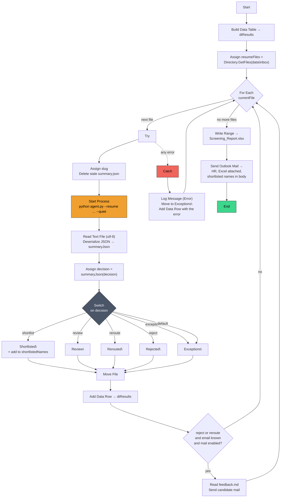

# UiPath Workflow — Intelligent Resume Screening

**For:** the teammate building this in UiPath Studio. No Python knowledge needed.
**Companion to:** `RPA_AGENT_PROMPT.md` (why), `PROGRESS.md` Section F (what is built).

---

## 1. What you are building

HR drops a folder of resumes. The bot screens each one, files it into a decision
folder, builds one Excel report, and emails HR.

```
Python = the brain.  One command scores a resume and decides what happens to it.
UiPath = the hands.  Looping, moving, Excel, email, exceptions.
```

You never read or edit Python. You call **one command** per resume and read the
**one JSON file** it writes. That is the whole interface.

| You call | It gives you back |
|---|---|
| `agent.py` once per resume | a `summary.json` file + an exit code |

Everything in this document traces to a real file in this repo. Section 10 is
that traceability table — use it to check your build.

---

## 2. Before you open Studio

Prove the Python side works first, so that if something breaks later you know it
is the bot, not the brain. Open PowerShell in the repo root and run:

```powershell
powershell -ExecutionPolicy Bypass -File scripts\reset_demo.ps1
python scripts\run_inbox.py
```

`run_inbox.py` is **the workflow you are about to build**, written in Python. It
loops the inbox, calls the agent, and moves each file into its decision folder.
It does not write Excel and does not send mail — those are yours (activities 10
to 12). Use it as a reference: if your bot disagrees with it, your bot is wrong.

Expected output:

```
  Ananya Rao.pdf             review     -> Review
  Karthik Subramaniam.pdf    shortlist  -> Shortlisted
  Priya Menon.pdf            reroute    -> Rerouted
  Rohan Verma.pdf            shortlist  -> Shortlisted
  scanned_resume.png         exception  -> Exceptions
```

Run `scripts\reset_demo.ps1` again to put the five files back. Do that before
every demo and every test run — it is the only way to get a repeatable result.

---

## 3. The one command you call

```powershell
python agent.py --resume "data\inbox\Priya Menon.pdf" `
                --jd "data\jds\Microsoft - Data Analyst.pdf" `
                --jd-folder "data\jds" `
                --summary "data\out\runs\Priya_Menon\summary.json" `
                --quiet
```

| Argument | Meaning |
|---|---|
| `--resume` | the file HR dropped. **Always quote it** — the samples have spaces in their names |
| `--jd` | the job description being screened against |
| `--jd-folder` | the other open roles. Supplying this is what lets a rejected candidate be **rerouted** to a better-fitting role. Leave it out and you will never see a `reroute` decision |
| `--summary` | where to write the result. Give every resume its own folder |
| `--quiet` | print one machine-readable line only |

**Exit code:** `0` when the candidate got a decision, `1` when the file could not
be screened. Do not treat `1` as a crash — it is a valid outcome with a reason
attached, and the bot must carry on to the next file.

---

## 4. Workflow arguments — nothing hard-coded

Create these in the **Arguments** panel. Hard-coded paths are the single most
common reason a working bot breaks on another machine.

| Name | Direction | Type | Default |
|---|---|---|---|
| `in_RepoRoot` | In | `String` | `E:\HACKATHON-RADIX` |
| `in_PythonPath` | In | `String` | `python` |
| `in_InboxFolder` | In | `String` | `data\inbox` |
| `in_JdFile` | In | `String` | `data\jds\Microsoft - Data Analyst.pdf` |
| `in_JdFolder` | In | `String` | `data\jds` |
| `in_RunsRoot` | In | `String` | `data\out\runs` |
| `in_DecisionRoot` | In | `String` | `data\uipath` |
| `in_ReportPath` | In | `String` | `data\uipath\Screening_Report.xlsx` |
| `in_HrEmail` | In | `String` | *(your address while testing)* |
| `in_SendCandidateMail` | In | `Boolean` | `False` |
| `out_ScreenedCount` | Out | `Int32` | — |
| `out_ExceptionCount` | Out | `Int32` | — |

All folder arguments are **relative to `in_RepoRoot`**. Combine them with
`Path.Combine` and never with string concatenation:

```vbnet
Path.Combine(in_RepoRoot, in_InboxFolder)
```

---

## 5. Variables

| Name | Type | Scope | Purpose |
|---|---|---|---|
| `resumeFiles` | `String[]` | Main | every file HR dropped |
| `currentFile` | `String` | For Each | the file being screened |
| `dtResults` | `DataTable` | Main | one row per resume, becomes the Excel report |
| `summaryPath` | `String` | For Each body | where this resume's result will be written |
| `summaryText` | `String` | For Each body | the raw JSON text |
| `summaryJson` | `JObject` | For Each body | the parsed result |
| `slug` | `String` | For Each body | folder-safe candidate name |
| `decision` | `String` | For Each body | `shortlist` / `review` / `reroute` / `reject` / `exception` |
| `exitCode` | `Int32` | For Each body | `0` decided, `1` could not screen |
| `destFolder` | `String` | For Each body | the folder this file is moved to |
| `shortlistedNames` | `List(Of String)` | Main | for the HR email body |
| `feedbackBody` | `String` | For Each body | candidate feedback text, when there is any |

Initialise `shortlistedNames` to `New List(Of String)` in its Default field, or
the first `.Add` throws a null reference.

---

## 6. Main sequence

### 1 · Build Data Table → `dtResults`

Nine columns, all `String` except the two numbers. Keeping Readiness and Match
as `Int32` means Excel sorts them properly instead of alphabetically.

| Column | Type |
|---|---|
| `File` | String |
| `Name` | String |
| `Email` | String |
| `Readiness` | Int32 |
| `Match` | Int32 |
| `Decision` | String |
| `Reason` | String |
| `Rerouted To` | String |
| `Top Gaps` | String |

### 2 · Assign → `resumeFiles`

```vbnet
Directory.GetFiles(Path.Combine(in_RepoRoot, in_InboxFolder))
```

**Do not filter by extension.** A file the bot cannot read must reach the
Exceptions folder with a reason, not be silently skipped and left in the inbox.
The demo set deliberately includes `scanned_resume.png` to prove this works.

Sort for a stable demo: `Directory.GetFiles(...).OrderBy(Function(f) f).ToArray()`

### 3 · For Each → `currentFile` in `resumeFiles`

TypeArgument: `String`.

### 4 · Try Catch (inside the For Each, wrapping the whole body)

Everything from here to activity 8 goes in the **Try**. The Catch is section 7.
Without this, one bad file ends the run and HR gets nothing.

#### 4a · Assign → `slug`

The agent names its output folder after the candidate's file, with every
non-alphanumeric run replaced by an underscore. `Priya Menon.pdf` becomes
`Priya_Menon`. Compute the same thing so you know where to read from:

```vbnet
System.Text.RegularExpressions.Regex.Replace(
    Path.GetFileNameWithoutExtension(currentFile), "[^A-Za-z0-9]+", "_").Trim("_"c)
```

#### 4b · Assign → `summaryPath`

```vbnet
Path.Combine(in_RepoRoot, in_RunsRoot, slug, "summary.json")
```

#### 4c · Delete File → `summaryPath`

Only if it exists (`Path Exists` first, or tick ContinueOnError). This matters:
if the agent fails to run at all and a stale file from a previous run is sitting
there, you would read last run's answer and believe it. Delete first, then the
absence of the file is itself a reliable signal.

### 5 · Start Process — run the agent

Use **Start Process**, not **Invoke Power Shell**. Windows PowerShell 5.1 caused
real, hard-to-diagnose failures in this project — a script silently terminating
mid-loop with exit code 0 and no error (`PROGRESS.md` Section D #16, #17).
`Start Process` launches Python directly and takes PowerShell out of the picture.

| Property | Value |
|---|---|
| FileName | `in_PythonPath` |
| Arguments | the expression below |
| WorkingDirectory | `in_RepoRoot` |
| ContinueOnError | `True` |

```vbnet
"agent.py " &
"--resume """ & currentFile & """ " &
"--jd """   & Path.Combine(in_RepoRoot, in_JdFile) & """ " &
"--jd-folder """ & Path.Combine(in_RepoRoot, in_JdFolder) & """ " &
"--summary """ & summaryPath & """ " &
"--quiet"
```

Every path is wrapped in doubled quotes because the sample files have spaces in
their names. Miss one and the agent reads a truncated path and reports a file it
cannot find.

`Start Process` does not hand you an exit code directly. Two options:

- **Simplest:** ignore the exit code. The `decision` field in the JSON already
  tells you everything, and `exception` is exactly what exit `1` means.
- **If you want it:** use the **Invoke Process** activity (from
  `UiPath.Script.Activities`), which exposes `Result` as `Int32`, and store it in
  `exitCode`.

Set **WaitForExit / isWaiting = True** either way. Without it you read the
summary file before Python has written it.

Typical run time is 2 to 4 seconds. A rejected candidate takes longer — around
10 seconds — because the agent then re-scores them against every other open
role to look for a reroute. That is expected, not a hang.

### 6 · Read Text File → `summaryText`, then Deserialize JSON → `summaryJson`

**Read Text File**

| Property | Value |
|---|---|
| FileName | `summaryPath` |
| Encoding | `utf-8` |

Set the encoding explicitly. Leave it blank and some machines fall back to the
system codepage, which turns the dash in every reason into `—`.

**Deserialize JSON** — TypeArgument `JObject`, result into `summaryJson`.

Read the **file**, not the console output. The file is the contract. (The agent
also prints one line starting `RESULT_JSON ` with the same content, which is
handy when debugging by hand, but console text is easy to disturb and a file is
not.)

#### 6a · Assign → `decision`

```vbnet
summaryJson("decision").ToString()
```

### 7 · Switch → Move File

Switch on `decision`, TypeArgument `String`. Five cases plus a default:

| Case | `destFolder` |
|---|---|
| `shortlist` | `Shortlisted` |
| `review` | `Review` |
| `reroute` | `Rerouted` |
| `reject` | `Rejected` |
| `exception` | `Exceptions` |
| *Default* | `Exceptions` |

Give the Default case the Exceptions folder too. If a future version of the
agent returns a decision you have not coded, the file still lands somewhere a
human will look, instead of staying in the inbox and being screened again
tomorrow.

In each case: **Assign** `destFolder`, then after the Switch do one **Move File**:

| Property | Value |
|---|---|
| Path | `currentFile` |
| Destination | `Path.Combine(in_RepoRoot, in_DecisionRoot, destFolder, Path.GetFileName(currentFile))` |
| Overwrite | `True` |

Put a **Create Directory** on the destination folder before the move, or the
first run fails on a folder that does not exist yet.

For `shortlist`, also add the name to the email list:

```vbnet
shortlistedNames.Add(summaryJson("candidate_name").ToString())
```

### 8 · Add Data Row → `dtResults`

ArrayRow:

```vbnet
{
  Path.GetFileName(currentFile),
  summaryJson("candidate_name").ToString(),
  summaryJson("email").ToString(),
  If(summaryJson("readiness") Is Nothing OrElse summaryJson("readiness").Type = Newtonsoft.Json.Linq.JTokenType.Null,
     0, CInt(summaryJson("readiness"))),
  If(summaryJson("match") Is Nothing OrElse summaryJson("match").Type = Newtonsoft.Json.Linq.JTokenType.Null,
     0, CInt(summaryJson("match"))),
  decision,
  summaryJson("reason").ToString(),
  summaryJson("rerouted_to_role").ToString(),
  String.Join("; ", summaryJson("top_gaps").Select(Function(t) t.ToString()))
}
```

Two things that will bite you if you skip them:

- **`readiness` and `match` can be null** when a file could not be read. Casting
  null straight to `Int32` throws. The `If` above turns it into `0`.
- **`top_gaps` and `missing_skills` are JSON arrays**, not strings. Dropping a
  `JArray` into a String cell gives you `["Coding","SQL"]` with the brackets.
  `String.Join` turns it into `Coding; SQL`.

---

## 7. The Catch block

Catch `System.Exception`. The whole point is that the loop continues.

1. **Log Message** — Level `Error`:
   ```vbnet
   "Could not screen " & Path.GetFileName(currentFile) & ": " & exception.Message
   ```
2. **Create Directory** — `Path.Combine(in_RepoRoot, in_DecisionRoot, "Exceptions")`
3. **Move File** — `currentFile` into that folder, Overwrite `True`
4. **Add Data Row** — so the file appears in the report rather than vanishing:
   ```vbnet
   { Path.GetFileName(currentFile), "", "", 0, 0, "exception",
     "Bot error: " & exception.Message, "", "" }
   ```
5. **Assign** — `out_ExceptionCount = out_ExceptionCount + 1`

Do **not** put a Rethrow or a Terminate Workflow here. One unreadable file must
never cost HR the other 49 results.

---

## 8. After the loop

### 9 · Assign → counts

```vbnet
out_ScreenedCount = dtResults.Rows.Count
```

### 10 · Write Range → `Screening_Report.xlsx`

Inside an **Excel Application Scope** (or **Use Excel File**) on `in_ReportPath`:

| Property | Value |
|---|---|
| SheetName | `All` |
| Range | `""` |
| DataTable | `dtResults` |
| AddHeaders | `True` |

**Bonus — one sheet per decision.** A For Each over
`{"shortlist","review","reroute","reject","exception"}` with a **Filter Data
Table** then a **Write Range** per sheet. HR opening straight onto the
Shortlisted tab is a nice touch, but get the single sheet working first.

### 11 · Send Outlook Mail Message → HR

| Property | Value |
|---|---|
| To | `in_HrEmail` |
| Subject | see below |
| Attachments | `in_ReportPath` |
| IsBodyHtml | `False` |

```vbnet
"Resume screening complete - " & out_ScreenedCount.ToString() & " candidates"
```

```vbnet
"Screening run complete." & Environment.NewLine & Environment.NewLine &
"Shortlisted (" & shortlistedNames.Count.ToString() & "):" & Environment.NewLine &
If(shortlistedNames.Count = 0, "  none", "  " & String.Join(Environment.NewLine & "  ", shortlistedNames)) &
Environment.NewLine & Environment.NewLine &
"Full results attached. Candidates needing a human decision are on the Review sheet." &
Environment.NewLine &
"Exceptions: " & out_ExceptionCount.ToString()
```

No Outlook on the machine? Use **Send SMTP Mail Message** instead — same
properties plus Server, Port, Email and Password. Put the credentials in
Orchestrator Assets or Windows Credential Manager, never in the workflow.

### 12 · Candidate feedback mail (optional, inside the loop)

For `reject` and `reroute` the agent writes a short, kind, plain-English note
for the candidate. The summary tells you where:

```vbnet
summaryJson("feedback_file").ToString()    ' e.g. data/out/runs/Priya_Menon/feedback.md
```

Guard it with three conditions, all of which really occur:

```vbnet
in_SendCandidateMail _
  AndAlso summaryJson("feedback_file").ToString() <> "" _
  AndAlso summaryJson("email").ToString() <> ""
```

Then **Read Text File** (Encoding `utf-8`) into `feedbackBody` and send it.

**The sample resumes have no email address in them at all** — `email` is always
empty for the demo set (`PROGRESS.md` Section D #13). So this step will skip
every time on sample data. That is correct behaviour, not a bug: log it at
`Info` level and move on. Never let a missing address stop the file move or the
report row.

Keep `in_SendCandidateMail` set to `False` until someone has read the generated
text and approved it. Mail to candidates is not something to discover in
production.

---

## 9. Exception handling

| What happens | What the agent does | What your bot does |
|---|---|---|
| Resume is a scan, a photo, or a `.png` | exit `1`, `decision: "exception"`, reason `Unsupported file type '.png' …` | move to `Exceptions\`, add row, **continue** |
| PDF is empty or corrupt | exit `1`, `decision: "exception"`, reason `Cannot read an empty file` | move to `Exceptions\`, add row, **continue** |
| Resume is fine but scores low, and no better role exists | exit `0`, `decision: "reject"` | move to `Rejected\`, write feedback mail if enabled |
| Resume scores low here but fits another open role | exit `0`, `decision: "reroute"`, `rerouted_to_role` filled in | move to `Rerouted\`, tell HR which role fits |
| `candidate_name` is blank | normal — the name could not be read | keep the row, show the filename; do not skip |
| `email` is blank | normal for every sample resume | skip the candidate mail only, log `Info` |
| `readiness` / `match` are `null` | the scoring stages did not run | store `0` in the DataTable (see 8) |
| Python is not on PATH | nothing runs, no summary file written | Catch fires, file to `Exceptions\`, **fix `in_PythonPath`** — if every file errors, this is why |
| `summary.json` missing after the run | agent could not start | Catch fires; check `in_RepoRoot` and that `agent.py` is there |
| Excel file open in Excel | — | Write Range throws. Close it. Worth a Retry Scope |
| Inbox is empty | — | `resumeFiles` is empty, loop does nothing. Run `reset_demo.ps1` |
| Same resume screened twice | overwrites its own run folder, appends a second audit row | harmless; the audit log is append-only by design |

Rule of thumb: **a decision is never an error.** `reject` and `exception` are
outcomes the workflow is supposed to produce. The only real errors are "Python
did not run" and "Excel would not open".

---

## 10. Traceability — every activity to a real thing in this repo

This is the review check: a reviewer should be able to point at any activity and
find the file or command it talks to.

| # | Activity | Traces to |
|---|---|---|
| 1 | Build Data Table | columns match `screening_log.csv`'s header — see `core/storage.py` `SCREENING_LOG_COLUMNS` |
| 2 | Assign `resumeFiles` | `data\inbox\` — populated by `scripts/reset_demo.ps1` from `data\inbox_seed\` |
| 3 | For Each | the loop in `scripts/run_inbox.py` |
| 4 | Try Catch | the `try/except` around the loop body in `scripts/run_inbox.py` |
| 4a | `slug` regex | `_slug()` in `agent.py` — identical expression |
| 5 | Start Process | `agent.py`, section 3 above; `main()` in `agent.py` |
| 6 | Read Text File + Deserialize JSON | the file written by `--summary`, via `core/storage.py` `save_json` |
| 6a | `decision` | set by `decide()` in `modules/m6_screening_agent.py`, upgraded to `reroute` by `screen_resume()` in `agent.py` |
| 7 | Switch + Move File | `FOLDER_FOR` in `scripts/run_inbox.py`; destination folders exist in `data\uipath\` |
| 8 | Add Data Row | field names are the keys of `summary.json` — `build_summary()` in `pipeline.py` plus the four reroute fields in `agent.py` |
| 10 | Write Range | `data\uipath\Screening_Report.xlsx`, cleared by `scripts/reset_demo.py` |
| 11 | Send Outlook Mail | `shortlistedNames`, from `decision == "shortlist"` |
| 12 | Candidate mail | `feedback_file` in the summary → `feedback_markdown()` in `modules/m6_screening_agent.py` |
| — | audit log | `data\out\screening_log.csv`, appended by `append_log_row()` in `core/storage.py` |
| — | thresholds | `config\screening.json`, chosen by `scripts/calibrate.py` |
| — | company per JD | `config\jd_companies.json`, read by `agent.py` |

---

## 11. `summary.json` field reference

A real file, exactly as the agent wrote it:

```json
{
  "resume_file": "data/inbox/Priya Menon.pdf",
  "candidate_name": "Priya Menon",
  "email": "",
  "company": "Microsoft Corporation",
  "role": "Data Analyst",
  "readiness": 24,
  "verdict": "Significant gaps",
  "match": 15,
  "top_gaps": ["Data Structures & Algorithms", "Object Oriented Programming & Design", "Communication Skills"],
  "missing_skills": ["Query", "Quantitative", "Communication", "Stakeholder", "Dashboard"],
  "decision": "reroute",
  "reason": "Average fit 19 for Data Analyst, but Application Support Analyst at Oracle Financial Services Software Limited scores 27 (+8) — a better fit for this candidate.",
  "stages_ok": 5,
  "error": "",
  "rerouted_to_role": "Application Support Analyst",
  "rerouted_to_company": "Oracle Financial Services Software Limited",
  "rerouted_score": 27,
  "feedback_file": "data/out/runs/Priya_Menon/feedback.md"
}
```

| Field | Type | Notes |
|---|---|---|
| `resume_file` | String | repo-relative, forward slashes |
| `candidate_name` | String | can be `""` if unreadable |
| `email` | String | `""` for every sample resume |
| `company` | String | full legal name from the dataset |
| `role` | String | detected from the JD |
| `readiness` | Int or **null** | 0–100, how the candidate measures against the company's bar |
| `verdict` | String | plain-English band for `readiness` |
| `match` | Int or **null** | 0–100, fit against this specific posting |
| `top_gaps` | **Array** of String | full names, no codes. `String.Join` it |
| `missing_skills` | **Array** of String | up to 5. `String.Join` it |
| `decision` | String | the five values in section 7 |
| `reason` | String | one sentence, safe to show HR verbatim |
| `stages_ok` | Int | `5` is a clean run; less means something was skipped |
| `error` | String | `""` on a clean run |
| `rerouted_to_role` | String | `""` unless `decision` is `reroute` |
| `rerouted_to_company` | String | `""` unless `decision` is `reroute` |
| `rerouted_score` | Int or null | the better role's score |
| `feedback_file` | String | path to the candidate note, `""` unless reject/reroute |

Paths use forward slashes on purpose — they are safe in UiPath, in a CSV cell
and in JSON, and they survive being pasted between all three.

Why two scores? **`readiness`** answers *"could this person get hired here at
all?"* and **`match`** answers *"do they fit this particular posting?"* Someone
can be strong for the company and wrong for the role, which is exactly the case
a `reroute` catches. Worth saying in the demo.

### The audit log

`data\out\screening_log.csv` gets one row per screening, appended, never
overwritten. It is UTF-8 **with BOM**, so `Read CSV` and Excel both open it
correctly with no extra configuration. You do not need to write to it — the
agent does. Read it if you want a history across runs; the DataTable only has
the current one.

---

## 12. The flow



---

## 13. Build it in this order

Do not build all twelve activities and then test. Each step below is runnable.

| Step | Do this | You know it works when |
|---|---|---|
| 1 | Run section 2 by hand in PowerShell | you see five decisions and five moved files |
| 2 | Activities 1–3 + a Log Message of `currentFile` | the log lists all five filenames |
| 3 | Add activity 5, hard-coding one resume | `data\out\runs\<name>\summary.json` appears |
| 4 | Add activity 6 + Log Message of `decision` | the log prints `review`, `shortlist`, … |
| 5 | Add activities 7–8 | files land in the right folders; reset and repeat |
| 6 | Add the Try Catch (section 7) | the `.png` goes to `Exceptions\` and the loop finishes |
| 7 | Add activity 10 | the Excel file opens with 5 rows and 9 columns |
| 8 | Add activity 11 | you get the mail with the attachment |
| 9 | Add activity 12 last, `in_SendCandidateMail = False` | it skips cleanly and logs why |

Run `scripts\reset_demo.ps1` between every attempt. Testing on a half-empty
inbox will have you debugging a problem that is not there.

---

## 14. Things that will cost you an hour if nobody tells you

1. **Quote every path.** The samples are `Priya Menon.pdf`, with a space.
2. **Set `WaitForExit` / `isWaiting` to True**, or you read the summary file
   before Python writes it.
3. **Set Read Text File encoding to `utf-8`.** Otherwise dashes become `—`.
4. **`top_gaps` is an array.** `String.Join("; ", …)` it.
5. **`readiness` can be null.** Guard the `CInt`.
6. **Exit code 1 is not a crash.** It means "could not screen this file", which
   is a result you are meant to report.
7. **A rejected candidate takes ~10 seconds**, because the agent re-scores them
   against every other open role. Not a hang.
8. **Don't filter the inbox by extension.** Unreadable files must reach
   Exceptions, not be skipped.
9. **Reset before every run.** The bot empties the inbox by design.
10. **Don't edit anything under `data\out\`.** It is all generated and the reset
    wipes it. Your outputs belong in `data\uipath\`.

---

## 15. Next workflow (after this one works)

Human-in-the-loop, from `RPA_AGENT_PROMPT.md` R8. A second, much smaller
workflow:

1. **Read Range** — the `Review` sheet of `Screening_Report.xlsx`, which has an
   `HR Decision` column a human filled in with Approve or Reject
2. **For Each Row**
3. **Switch** on `HR Decision` → **Move File** from `Review\` to `Shortlisted\`
   or `Rejected\`
4. **Append Line** to a log of who moved what and when

The Python side of that is `scripts/apply_review.py`, which is not built yet.
Get this workflow finished first.
